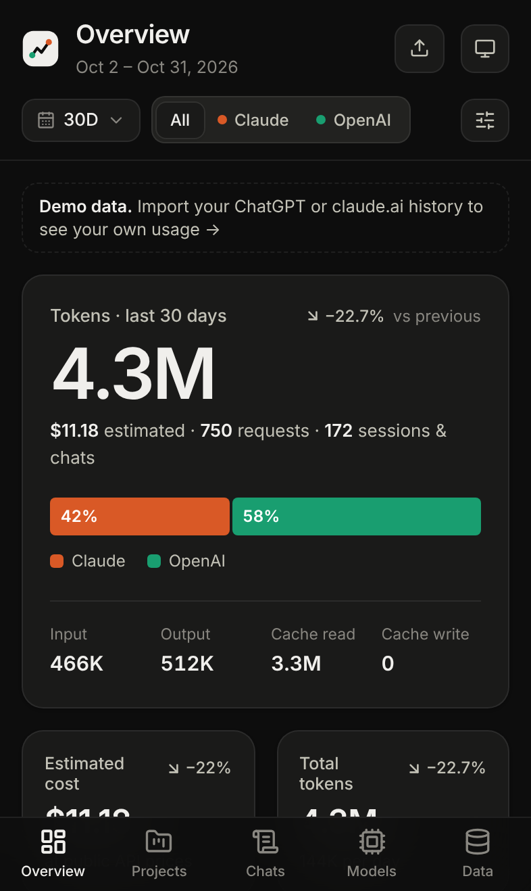
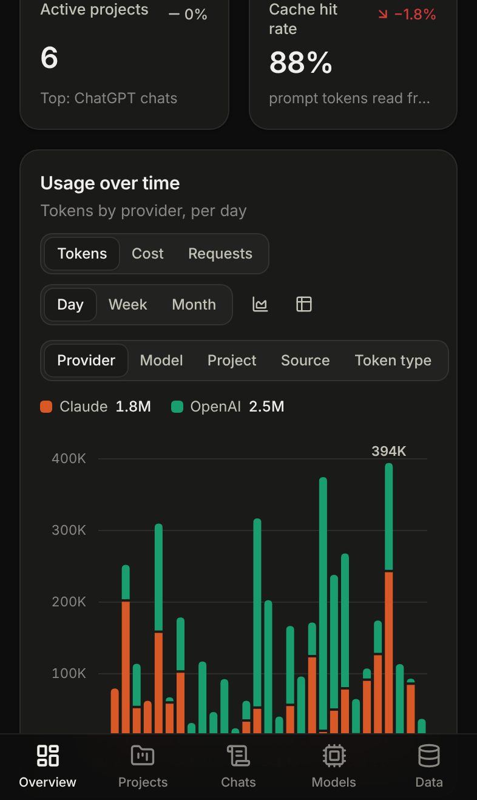
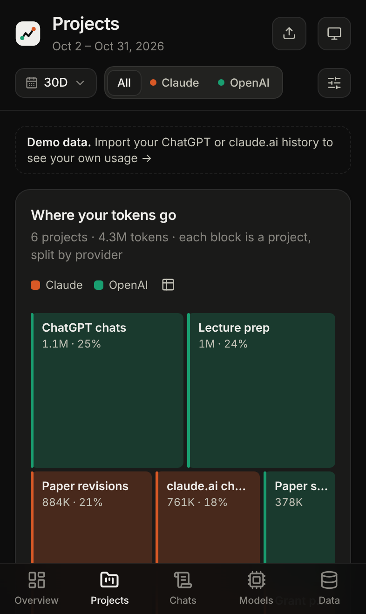
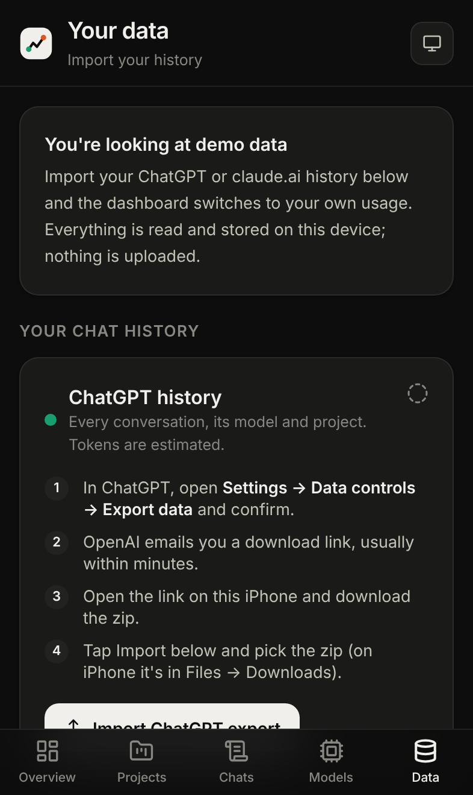
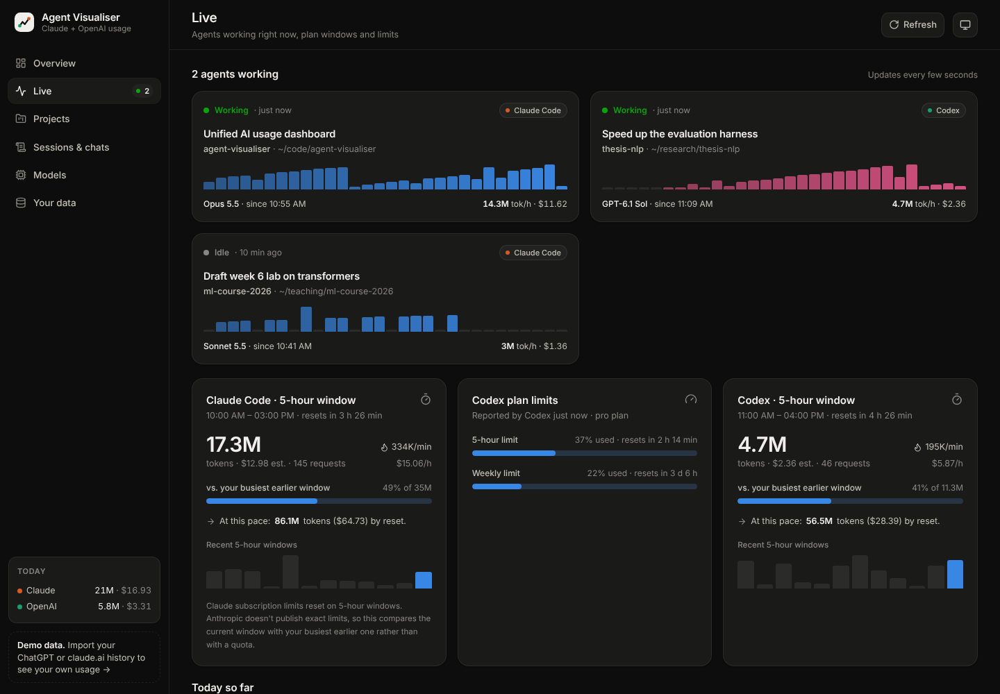
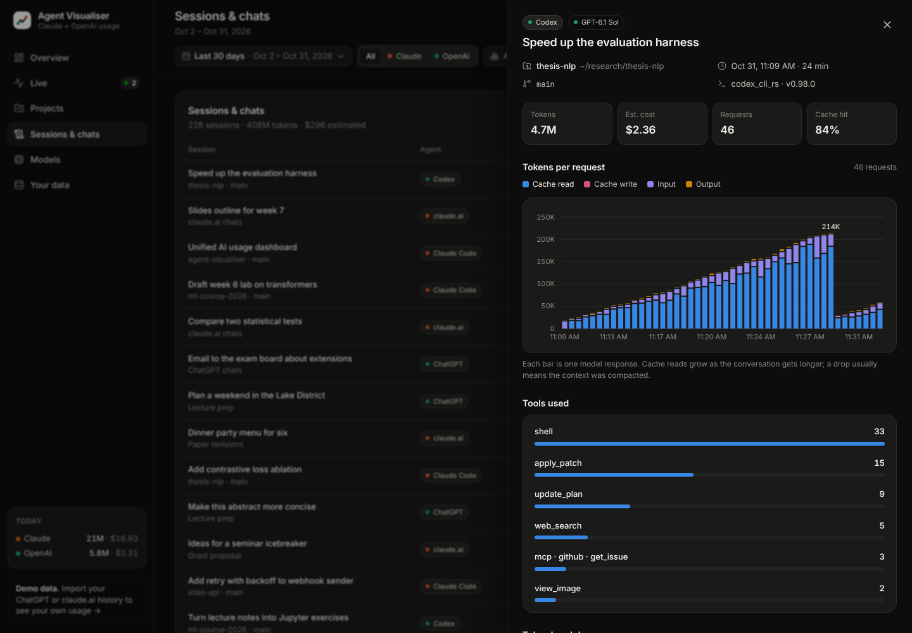
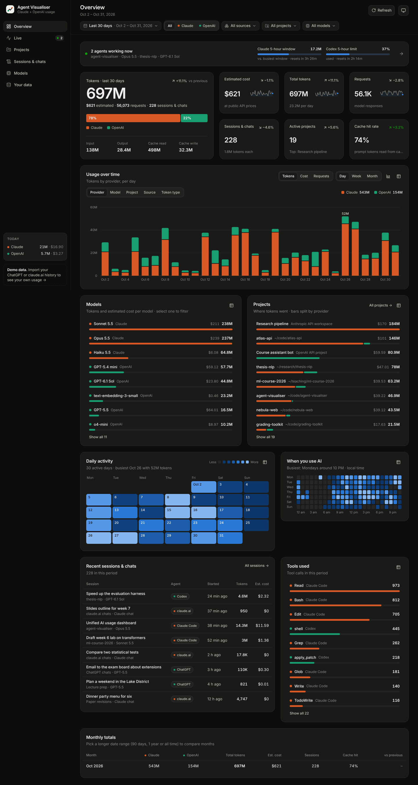

# Agent Visualiser

Your **Claude** and **OpenAI** usage in one place, on your **iPhone**: tokens, models and projects, by day and by
month. It works with personal accounts. Import the history exports that ChatGPT and claude.ai let you download, and
everything is analysed on the phone itself; nothing is uploaded anywhere.

| Overview | Trends | Projects | Your data |
| --- | --- | --- | --- |
|  |  |  |  |

There is also a desktop version that reads **Claude Code** and **Codex CLI** logs on a computer, with exact token counts
by folder and a live view of agents at work. See [On a computer](#on-a-computer-optional).

## On your iPhone

1. Open **https://nbjdttn.github.io/Agent-visualiser/** in Safari.
2. Tap **Share → Add to Home Screen**. It now opens full-screen like an app, works offline, and iOS keeps its data.
3. Open the **Data** tab and import your history:
   - **ChatGPT:** in ChatGPT go to **Settings → Data controls → Export data**. OpenAI emails you a link; open it on the
     iPhone, download the zip, then tap **Import ChatGPT export** and pick the zip (Files → Downloads).
   - **claude.ai:** on claude.ai go to **Settings → Privacy → Export data**. Anthropic emails you a link; download the zip
     on the iPhone and tap **Import claude.ai export**.
4. To update later (say, once a month), import a newer export. It replaces the old one, because exports always contain
   your full history.

Until you import something, the app shows a generated demo history so you can look around.

### What you'll see

- **Overview:** tokens and estimated cost for any period, the change from the previous period, the Claude/OpenAI split,
  usage per day, week or month (by provider, model, project, source or token type), a calendar of active days, when in
  the week you use AI, recent chats, tools used (web search, code, images) and monthly totals.
- **Projects:** a map of where your tokens go: ChatGPT projects, custom GPTs, Claude projects and everything else. Tap
  one for its own timeline, models and conversations. ChatGPT exports don't include project names, so you can rename
  them (the name is only stored on your phone).
- **Chats:** every conversation with its model, length, tokens and cost. Tap one to see how each reply re-read a growing
  conversation.
- **Models:** which models you used, how much, and what they would cost on the API.

### How the numbers are worked out

- **Tokens are estimates.** Chat exports contain your messages but no token counts, so the app counts about four
  characters per token (one per character for Chinese, Japanese and Korean). Every reply re-reads the conversation so
  far, so long chats add up quickly; that re-read part shows as "cache read".
- **Models:** ChatGPT records which model wrote each reply. claude.ai exports don't say, so those replies show as
  "Claude chat" with no cost estimate.
- **Cost** is what the same tokens would cost at public API prices, not what your subscription costs.
- **Not available on a phone:** the live "5-hour" and weekly plan limits. Neither Anthropic nor OpenAI offers a way for
  other apps to read them on personal accounts, so check those in the Claude and ChatGPT apps.

### Privacy

The app is a static web page. Files you import are read on the phone, and only the numbers it needs are kept (token
counts, model, title and time of each conversation, not the messages themselves). They live in the browser storage of
the Home Screen app, and **Data → Delete all imported data** removes them.

### Publishing the phone app (one-time setup, for the repository owner)

The workflow in `.github/workflows/phone-app.yml` builds the app and publishes it to GitHub Pages on every push to
`main`. GitHub needs to be told once to allow it: **Settings → Pages → Build and deployment → Source: GitHub Actions**,
then re-run the latest "Publish phone app" workflow from the Actions tab (or push to `main`).

## On a computer (optional)

If you run Claude Code or Codex CLI on a Mac, Windows or Linux machine, the same app can run there as a small local
server and add things a phone can't see:

- **Exact token counts** from Claude Code and Codex session logs, by **project folder**, session, git branch and tool.
- A **Live** view of agents working right now, the current 5-hour usage window, and Codex's own plan-limit percentages.
- Optional **organisation API** usage via admin keys (Anthropic Console or OpenAI organisations only).

```bash
npm install
npm run dev          # open http://127.0.0.1:5173
```

It finds `~/.claude` and `~/.codex` by itself (set `CLAUDE_CONFIG_DIR` / `CODEX_HOME` if you moved them), and you can
import chat exports on its Data page too.

| Command | What it does |
| --- | --- |
| `npm run dev` | API server + web app with hot reload, at http://127.0.0.1:5173 |
| `npm run dev:demo` | The same, always with demo data |
| `npm run build` then `npm start` | One production server for app and API, at http://127.0.0.1:4777 |
| `npm test` | Unit and API tests (Vitest) |
| `npm run typecheck` | TypeScript check of everything |
| `npm run update-pricing` | Refresh the built-in price list from LiteLLM |

Settings live in `.env` (see `.env.example`): `PORT`, `HOST` (keep `127.0.0.1`), `CLAUDE_CONFIG_DIR`, `CODEX_HOME`,
`ANTHROPIC_ADMIN_KEY`, `OPENAI_ADMIN_KEY`, `API_LOOKBACK_DAYS`, `PRICING_OFFLINE`, `DEMO`.

The desktop server listens on `127.0.0.1` only, rejects requests whose `Host` header isn't local (DNS-rebinding
protection), and requires a custom header for anything that changes data.

| Live view | Session detail |
| --- | --- |
|  |  |



### Agent log details

- **Claude Code** transcripts (`~/.claude/projects/**.jsonl`): each assistant response carries API usage. Responses
  written across several lines, or copied when you resume a conversation, are counted once; sub-agent work is marked.
- **Codex CLI** rollouts (`~/.codex/sessions/**/rollout-*.jsonl`, plain or `.zst`): per-response usage records, or the
  growth of the running total in older versions, plus the plan limits Codex reports.
- **Costs** use public per-token prices (cache writes and reads, long-prompt tiers, batch, fast mode and US-only
  inference where recorded), from LiteLLM's price list refreshed daily, with a built-in copy offline.
- **Double counting:** if agents run on an API key from the same organisation as an admin key, that usage appears in
  both the logs and the organisation report; use the Sources filter to look at one at a time.

## Project layout

```
core/                Runs on the phone and on the server
  parsers/           claudeCode, codex, chatgpt, claudeAi
  importer.ts        reads export zips, conversations.json and .jsonl files
  aggregate.ts       events -> daily/hourly facts, sessions, projects, models
  pricing.ts         price lookup and cost estimates (+ pricing-snapshot.json)
  demo.ts, live.ts   demo history; live sessions and 5-hour windows
server/              Desktop only: Hono API, log scanning, admin APIs, imports on disk
shared/types.ts      The dataset contract
src/                 React + Tailwind app; charts are hand-built SVG (d3-scale, d3-shape)
  lib/device.ts      Phone mode: imports in IndexedDB, parsed in a Web Worker
public/              Home Screen manifest, icons, offline service worker
tests/               Vitest suites with synthetic logs and exports
```

The same build runs in both places. When it's served by the desktop server it reads the API; anywhere else (GitHub
Pages) it keeps everything on the device.
