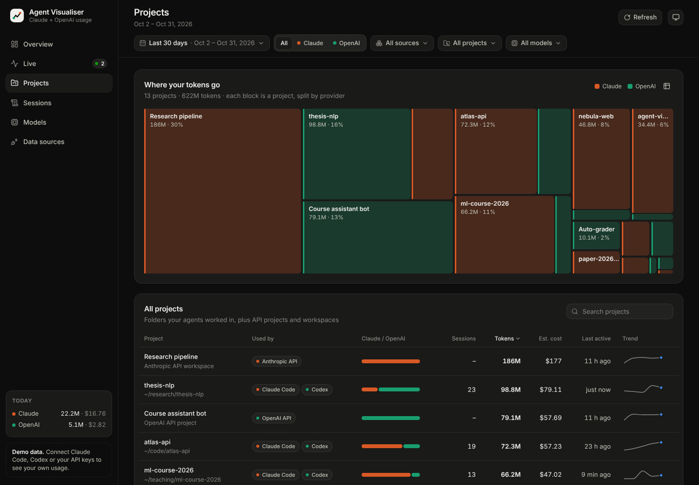
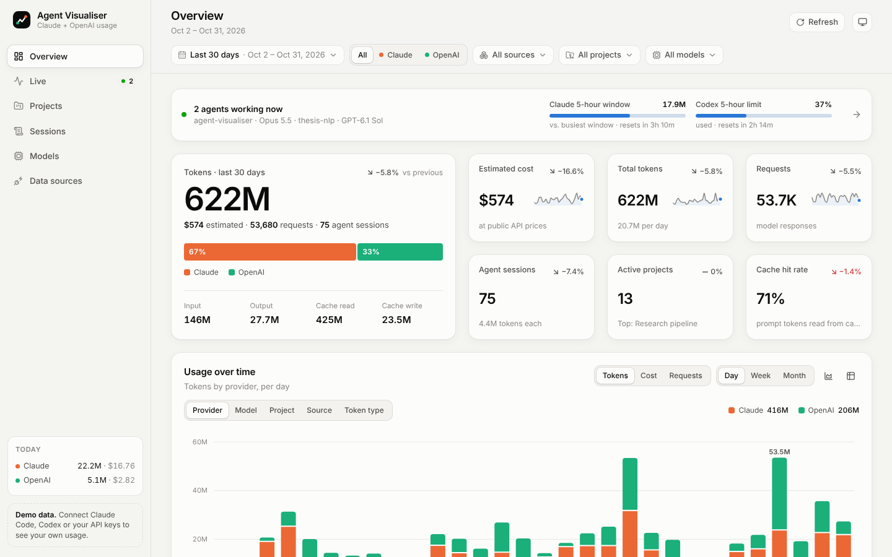

# Agent Visualiser

One dashboard for all your AI usage: **Claude** and **OpenAI**, local coding agents and organisation APIs, broken down
by **project folder, model, session, day and month**, with a live view of the agents that are working right now.


It reads the session logs that **Claude Code** and the **OpenAI Codex CLI** already write on your machine, so you can see
which agent worked in which folder, with which model, and how many tokens it spent. If you have admin keys, it adds your
**Anthropic API** and **OpenAI API** organisation usage too. Everything runs locally; your logs never leave your machine.

## Quick start

Requires Node.js 20.19 or newer (22+ recommended).

```bash
npm install
npm run dev          # open http://127.0.0.1:5173
```

Nothing to configure for local agents: the app finds `~/.claude` and `~/.codex` by itself. If neither has any usage yet, it
shows a generated demo history so you can look around; it switches to your real data as soon as there is some.

| Command | What it does |
| --- | --- |
| `npm run dev` | API server + Vite dev server with hot reload, at http://127.0.0.1:5173 |
| `npm run dev:demo` | The same, but always with demo data |
| `npm run build` then `npm start` | One production server for app and API, at http://127.0.0.1:4777 |
| `npm run demo` | Production server with demo data (after `npm run build`) |
| `npm test` | Unit and API tests (Vitest) |
| `npm run typecheck` | TypeScript check of server, app and tests |
| `npm run update-pricing` | Refresh the bundled price list from LiteLLM |

## What you can see

- **Overview**: headline tokens and estimated cost for any period, the change against the previous period, the split
  between Claude and OpenAI, usage over time (by provider, model, project, source or token type; per day, week or month),
  top models and projects, a daily activity calendar, when in the week your agents work, recent sessions, the tools the
  agents used most, and monthly totals.
- **Live**: every Claude Code and Codex session that is running or ran in the last 20 minutes, with its folder, model,
  per-minute token burn and cost; your current 5-hour usage window with burn rate and projection; and the plan limits
  Codex reports (5-hour and weekly).
- **Projects**: a treemap of where your tokens go and a sortable table of every folder (and API project or workspace),
  each split into Claude and OpenAI. Click a project for its own timeline, models, tools and sessions.
- **Sessions**: every agent session with its title, folder, branch, model, duration, tokens and cost. Click one for a
  per-request chart of how its context grew, the tools it called and how much went to sub-agents.
- **Models**: usage over time per model and a comparison table (share, tokens per request, cache hit rate, price).
- **Data sources**: what was found where, and how numbers are computed.

Overview, Projects, Sessions and Models share one row of filters: date range, provider, source, project and model.
Click a model or project to filter by it. Each chart can switch to a table of the same numbers, and there are light and
dark themes.

| Live | Session detail |
| --- | --- |
|  |  |

| Projects | Light theme |
| --- | --- |
|  |  |

## Data sources

| Source | Where it comes from | Granularity | Setup |
| --- | --- | --- | --- |
| **Claude Code** | `~/.config/claude/projects` and `~/.claude/projects` (JSONL transcripts, including sub-agents) | every response, with folder, session, branch, tools | none; set `CLAUDE_CONFIG_DIR` if you moved it |
| **Codex CLI** | `~/.codex/sessions` and `archived_sessions` (JSONL rollouts, plain or `.zst`) | every response, with folder, session, git repo, tools, plan limits | none; set `CODEX_HOME` if you moved it |
| **Anthropic API** | Admin API `usage_report/messages` + workspaces | per day, model and workspace | `ANTHROPIC_ADMIN_KEY` in `.env` |
| **OpenAI API** | Admin API `organization/usage/completions` and `/embeddings` + projects | per day, model and project | `OPENAI_ADMIN_KEY` in `.env` |

To connect the APIs, copy `.env.example` to `.env` and add the keys you have:

```bash
cp .env.example .env
# ANTHROPIC_ADMIN_KEY=sk-ant-admin01-...   (an Admin API key from your Claude Console organisation)
# OPENAI_ADMIN_KEY=sk-admin-...            (an Admin key from your OpenAI platform organisation settings)
```

Admin keys are an organisation feature on both platforms; individual accounts don't have them, and the local agent logs
work without them.

API usage is fetched for the last 90 days (`API_LOOKBACK_DAYS`), cached in `~/.cache/agent-visualiser`, and refreshed every
30 minutes; finished days are never fetched twice.

**Not covered:** chats in the ChatGPT and claude.ai apps. Neither product exposes token counts, so there is nothing to
read. Codex used with a ChatGPT plan is covered, through its local logs.

## How the numbers work

- **Tokens** are split into input (new, uncached prompt tokens), cache writes, cache reads and output (which includes
  reasoning). Coding agents re-send their whole context on every step, so cache reads are usually most of the total.
- **Cost** is an estimate at public per-token API prices, including cache write and read rates, long-prompt tiers, batch
  discounts, fast mode and US-only inference where the logs record them. Prices come from LiteLLM's public price list,
  refreshed daily, with a bundled snapshot as the offline fallback (`PRICING_OFFLINE=1` to stay offline). On a Claude
  Pro/Max or ChatGPT plan this is the API-equivalent value of your usage, not what you pay.
- **Projects** are the folders the agents ran in. When Claude Code and Codex both worked in the same folder, they count
  towards one project. API usage is grouped by OpenAI project or Anthropic workspace.
- **Duplicates** are removed: a response written across several log lines, or copied into a new file when you resume a
  conversation, is counted once.
- **5-hour windows** group Claude Code (and Codex) usage the way subscription limits reset: a window starts on the hour of
  your first message and lasts five hours. Anthropic doesn't publish exact limits, so the meter compares the current
  window with your busiest earlier one. Codex reports its real limit percentages, which are shown as-is.
- **Double counting:** if your agents run on an API key from the same organisation as your admin key, that usage shows
  up both in the local logs and in the organisation report. Use the Sources filter to look at one side at a time.

## Privacy and security

- Logs are read on your machine. The browser receives totals plus session titles and folder names, from your own server.
- The server listens on `127.0.0.1` only, rejects requests whose `Host` header isn't local (DNS-rebinding protection) and
  requires a custom header for the one endpoint that changes anything.
- Admin keys are read from `.env` (git-ignored) and only sent to `api.anthropic.com` and `api.openai.com`.
- If you set `HOST=0.0.0.0` to open the dashboard from another device, anyone who can reach that address can see your
  usage.

## Project layout

```
server/              Node API (Hono), run with tsx
  sources/           claudeCode.ts, codex.ts, apis.ts (admin APIs), demo.ts, files.ts
  pricing.ts         price lookup and cost estimates (+ pricing-snapshot.json)
  aggregate.ts       events -> daily/hourly facts, sessions, projects, models
  live.ts            active sessions, 5-hour windows
  store.ts, app.ts   scanning, caching and HTTP routes
shared/types.ts      the dataset contract shared by server and app
src/                 React + Tailwind dashboard; charts are hand-built SVG (d3-scale/d3-shape)
tests/               Vitest suites with synthetic log fixtures
```

The server parses each log file once and re-reads only files that changed, so it stays quick on large histories. The app
polls `/api/live` every 8 seconds and reloads the dataset when something new was written.
